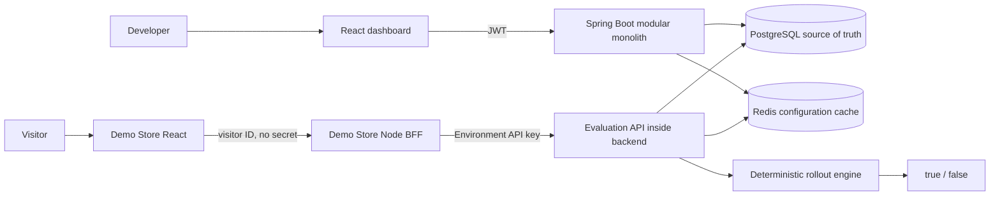

# ReleasePilot

Feature management and progressive delivery platform for safely releasing functionality without redeploying applications.

ReleasePilot separates **deploying code** from **releasing a feature**. Change a flag in the dashboard; an external application evaluates it at runtime and changes its behaviour. The included **Morrow Demo Store** switches between two checkout experiences using the real `new_checkout` flag.

## Why ReleasePilot?

A deployment should not require exposing a feature to everybody at once. ReleasePilot supports progressive rollouts, separate environment configurations and an OFF switch to disable a feature on the next evaluation. Stable bucketing keeps a visitor's decision consistent for an unchanged rollout.

## Features

- Runtime ON/OFF feature flags and kill switches.
- Development, Staging and Production configurations per project.
- Percentage rollouts from 0 to 100 with deterministic SHA-256 bucketing.
- Environment API keys, one-time secret display and revocation.
- PostgreSQL persistence, Flyway migrations, Redis cache-aside and invalidation.
- Transactional audit logs for configuration and credential changes.
- JWT dashboard authentication and project ownership isolation.
- React dashboard: projects, flags, environments, API keys and audit history.
- Independent Demo Store with a server-side API-key integration and safe V1 fallback.
- Docker demo, OpenAPI contracts and GitHub Actions continuous integration.

## Architecture



The platform remains one deployable backend, organised by domain. Demo Store is an external consumer, separate from the dashboard. [Architecture and evaluation flow](docs/architecture.md) · [Technical decisions](DECISIONS.md).

## Progressive rollout

```text
SHA-256(UTF-8(userKey + ":" + flagKey))
→ all 32 bytes interpreted as an unsigned big-endian integer
→ bucket = integer modulo 100
→ enabled = flag is ON and bucket < rolloutPercentage
```

OFF wins. ON/0 includes nobody; ON/100 includes everybody. `user-123:new_checkout` produces bucket **60**: excluded at 60%, included at 61%. No random decision or browser-side rollout calculation.

## Tech stack

| Area | Implementation |
|---|---|
| Backend | Java 21, Spring Boot 3.5.16, Spring Security, JPA, Bean Validation, Flyway, Actuator |
| Dashboard / Store | React 19, TypeScript strict, Vite 7 |
| Demo BFF | Node.js 22 native HTTP and fetch |
| Persistence / cache | PostgreSQL 17 / Redis 7.4 |
| Testing | JUnit 5, Mockito, real-service Spring integration tests; Node test runner |
| Delivery | Maven Wrapper, npm lockfiles, Docker Compose, non-root app containers, Nginx, GitHub Actions CI |

## Project structure

```text
backend/             Java modular monolith, migrations and tests
frontend/            ReleasePilot dashboard
demo-store/          Independent storefront, BFF and integration smoke
docs/                API, architecture, commands and interview guide
scripts/             Environment setup/loading and repository checks
.github/workflows/   Backend and web CI
docker-compose.yml   Infrastructure by default; full application profile
DECISIONS.md         Architecture decision log
CURRENT_STATE.md     Verified state and validation evidence
```

## Quick start

Commands run from the root in **Windows PowerShell**. Docker Desktop must use Linux containers. Full Docker requires Compose **2.24+** and PowerShell; development also requires Java 21 and Node **22.23.3** or newer compatible Node 22.

### Mode B — complete Docker demo

```powershell
Set-ExecutionPolicy -Scope Process -ExecutionPolicy Bypass
./scripts/init-local-env.ps1
docker compose --profile full config --quiet
docker compose --profile full up --build -d --wait --wait-timeout 180
```

The initializer creates ignored `.env` with random local PostgreSQL/JWT secrets and preserves an existing file. Six services have healthchecks. No private credentials are needed to build; Demo Store starts safely on V1 until its Production API key is configured.

| Service | Full Docker | Development |
|---|---|---|
| Dashboard | http://127.0.0.1:15173 | http://127.0.0.1:5173 |
| Backend | http://127.0.0.1:18080 | http://localhost:8080 |
| Demo Store | http://127.0.0.1:15174 | http://127.0.0.1:5174 |
| Demo BFF | Docker network only | http://127.0.0.1:3001 |
| PostgreSQL / Redis | Loopback 5432 / 6379 | Same infrastructure |

1. Register/Login in the Docker dashboard.
2. Create **Demo Store**, select **Production**, create flag key **new_checkout**.
3. Generate a Production API key. Create `demo-store/.env` from its `.env.example` and insert the one-time secret into `RELEASEPILOT_API_KEY`. Never use a `VITE_` variable for a secret.
4. Apply server configuration without rebuilding the storefront:

```powershell
docker compose --profile full up -d --no-deps --force-recreate demo-bff
Invoke-RestMethod http://127.0.0.1:18080/actuator/health
```

Health returns `UP` when PostgreSQL/Redis are healthy. Docker BFF uses `http://backend:8080` regardless of the local .env base URL. [Complete launch, fixture alternatives and stop commands](docs/commands.md).

### Mode A — development

Initialize/load root `.env`, start `docker compose up -d --wait --wait-timeout 60` for PostgreSQL/Redis, then use separate terminals for backend `mvnw.cmd spring-boot:run`, dashboard `npm run dev`, and Demo Store `npm run server` plus `npm run dev`. Run `npm ci` in each web application first. [Copyable PowerShell commands](docs/commands.md) give exact working directories and environment loading.

## Demo

Add a product, open the cart and checkout. Change Production in the dashboard, then click **Re-evaluate** in the store:

| `new_checkout` | Behaviour |
|---|---|
| OFF | Classic Checkout V1 |
| ON / 30% | V1 or V2, stable per visitor at the same rollout |
| ON / 100% | New Checkout V2 for everybody |
| OFF again | V1 on the next evaluation, no redeployment |
| Error / invalid API key | Safe V1 fallback, store remains usable |

**Generate another visitor** replaces the visitor ID as a clearly marked demo tool. The ID persists in localStorage. The debug panel shows flag/decision/reason, never the API key. There is no payment processing or persistent order.

Optional setup/smoke scripts reuse one dedicated fixture and restore its configuration after each test. [Demo Store instructions](demo-store/README.md).

## Security

- BCrypt cost 12, 72 UTF-8 byte limit; passwords never returned in HTTP DTOs.
- Signed HS256 JWT with environment-specific secret and expiry; browser token in sessionStorage.
- Random 256-bit API-key secrets; only SHA-256 hashes stored. Revocation checked in PostgreSQL on every evaluation.
- Services enforce owner/parent scope; foreign resources return 404. Evaluation scope comes only from the API key.
- Demo key stays server-side; secrets/fixtures excluded from Git and Docker contexts.
- Dashboard CORS has one exact origin, no wildcard/credentials; Docker uses same-origin API proxies.
- Errors omit stacktraces and rejected values; audit records omit credentials.

Public deployment requires HTTPS and abuse protection. Logout removes the browser token without revoking an already issued JWT. Docker runtime variables are visible to its administrator. [Security review and limitations](docs/security.md).

## Testing

Final local validation: **50 backend + 16 dashboard + 15 Demo Store = 81 passing tests**, no failures/errors/skips. Both production web builds pass. Six full-profile containers are healthy; real smoke covers Login, OFF / stable 30% / 100% / OFF, Audit and invalid-key fallback. Evidence: [CURRENT_STATE.md](CURRENT_STATE.md).

```powershell
# Root; PostgreSQL/Redis active
. ./scripts/load-local-env.ps1
Push-Location backend
.\mvnw.cmd verify
Pop-Location

Push-Location frontend
npm ci
npm test
npm run build
Pop-Location

Push-Location demo-store
npm ci
npm test
npm run build
Pop-Location

node scripts/verify-repository.mjs
```

Stop Vite before `npm ci` on Windows to release native dependency locks. Backend tests use real services, no H2 substitute; rollback/targeted cleanup preserves existing projects.

CI runs backend verify with PostgreSQL/Redis and npm ci/test/build for both web apps, using only public test credentials. The workflow is created and locally checked; a hosted green run requires publication. No automated production deployment pipeline is claimed.

## API documentation

Validated OpenAPI 3.0: [Auth](docs/openapi-auth.yaml), [Core](docs/openapi-core.yaml), [Evaluation/API keys](docs/openapi-evaluation.yaml). Import them into Swagger Editor; no server Swagger UI endpoint is claimed. Guides: [Auth](docs/auth.md), [Core](docs/core-domain.md), [Evaluation](docs/evaluation.md), [Frontend](docs/frontend.md).

## Engineering decisions

[DECISIONS.md](DECISIONS.md) documents boundaries, JWT/API keys, hashing, versioned invalidation, transactional audits, BFF secrets and delivery. [Interview guide](docs/interview-guide.md) contains pitches, trade-offs, limitations, 30 questions and concise CV bullets.

## Non-goals and future improvements

Advanced targeting, teams/RBAC, official SDKs and advanced analytics are possible extensions, not implemented features. The MVP excludes A/B testing, billing and real payments. No microservices, Kafka, Kubernetes or observability platform is needed for this demo.
