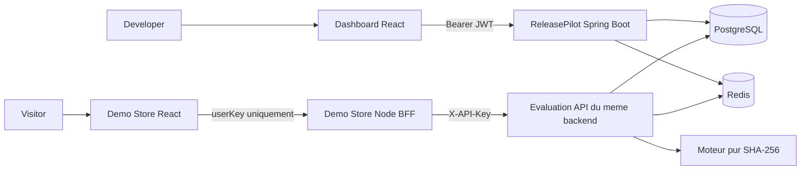
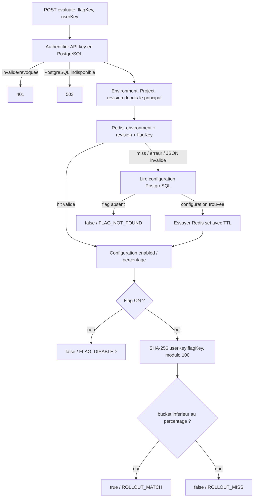

# Architecture de ReleasePilot

ReleasePilot est un modular monolith Java 21/Spring Boot. Les domaines auth, user, project, environment, featureflag, evaluation, apikey, cache, audit, security et shared ont des responsabilites identifiables. Controllers : HTTP/DTO/validation ; services : authorization, transactions et logique metier ; repositories : persistance.

## Vue systeme

PostgreSQL conserve users, projects, environments, flags, configurations, API-key hashes et audits. Flyway V1..V4 est l'autorite sur le schema ; Hibernate valide, sans DDL automatique. Redis conserve seulement enabled/rolloutPercentage avec un TTL. Le BFF externe n'a aucune base e-commerce ou cache de decisions.

## Flow d'evaluation

Le schema montre la decision mathematique ; l'implementation court-circuite ON/0 et ON/100 avant hashing. Aucun cache d'authentification : PostgreSQL est lu pour chaque API key. Une panne PostgreSQL ne permet donc pas de continuer seulement avec Redis. Une panne Redis augmente potentiellement la latence (timeouts de 2 s), mais l'evaluation utilise PostgreSQL. Le health global peut etre DOWN pendant cette panne alors que l'evaluation reste utilisable.

## Mutation, cache et audit

Les mutations d'un projet existant prennent son verrou pessimiste PostgreSQL. La configuration et `projects.evaluation_revision` changent dans la meme transaction que l'audit. Apres commit, les anciennes cles concernees sont aussi evincees de Redis. Au rollback, aucune invalidation n'est declenchee.

Cle Redis : `flag-config:v1:{environmentId}:{projectEvaluationRevision}:{flagKey}`. La revision fait ignorer une ancienne generation meme si une lecture retardee la recharge apres eviction, ou si Redis revient apres une panne. Les anciennes generations expirent au TTL. Toute mutation de configuration invalide logiquement le cache du projet entier. Une requete deja authentifiee peut terminer avec la revision lue avant le commit ; ce MVP ne pretend pas annuler les requetes en cours.

Les suppressions des enfants sont explicites, sans cascade REMOVE. Les audits historiques restent consultables par le proprietaire, meme apres suppression du projet. L'audit n'expose ni secret ni hash de credential.

## Livraison locale

Compose sans profil : PostgreSQL et Redis ; Java/Vite/Node sur l'hote. Profil `full` : ajout du backend, Nginx dashboard, BFF et Nginx Demo Store. PostgreSQL utilise le meme volume dans les deux modes. Les ports applicatifs Docker distincts evitent les collisions avec le dev.

Les images web ne copient que les sources/package-lock/configurations necessaires. Les fichiers .env/.local sont exclus des contextes. Le backend compile avec JDK 21 puis tourne avec JRE 21 ; le BFF n'a besoin d'aucun package npm runtime. Tous les processus applicatifs Docker tournent avec un utilisateur non-root. Les APIs web Docker passent par des proxies Nginx de meme origine avec resolution DNS Docker renouvelee ; aucun secret n'est injecte dans un build frontend.

Voir [commands.md](commands.md), [security.md](security.md) et ADR-019 dans [DECISIONS.md](../DECISIONS.md).
